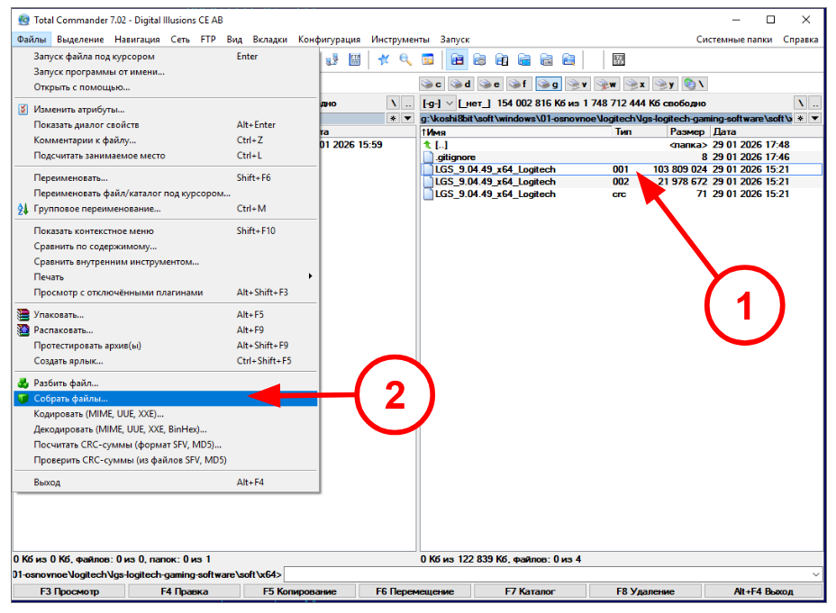

# Как добыть "exe" файл

## Проблема
Я бы выложил файл целиком, но github.com ограничивает размер загружаемого файла до 100 (или 50 МБ).

По этому пришлось бить файл по блокам. Для сборки следует использовать `Total commander` с возможностью разбиения и сборки файлов.

Сборка файлов показана на рисунке ниже:
1. Выбираем первый файл, с расширением `*.001` (Например `lgs\x64\LGS_9.04.49_x64_Logitech.001`)
1. Выбираем `Собрать файлы...`
1. Выбираем папку, куда сохранить файл. Если очистить поле - файл будет сохранент в ту же папку, где лежит файл `*.001`
1. Запускаем установщик

